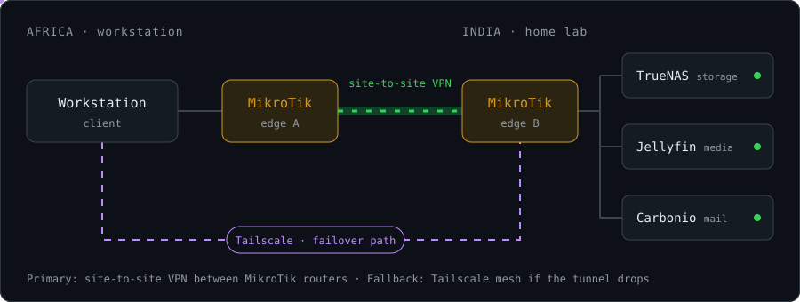

<p align="center">
  
</p>

<p align="center">
  
</p>

<p align="center">
  
  
  
  
  
  
  
</p>

<p align="center">
  
  
  
  
</p>

```bash
rishabh@altair:~$ whoami
name       = "Rishabh Vyas"
role       = "System & Network Engineer @ Krystalline Salt Ltd."
builds     = ["AI agent workflows (Claude Code, Codex)", "Frappe & Django apps", "CI merge gates"]
education  = "MSc Cyber Security (First Class Honours), National College of Ireland"
certs      = ["CEH", "IBM Cybersecurity Analyst", "TryHackMe Pre Security"]
runs       = ["Django", "Frappe", "GitHub org CI", "MikroTik networks"]
leads      = "a team of developers"
homelab    = ["TrueNAS", "Jellyfin", "Carbonio"]
learning   = "offensive security"   # TryHackMe, Jr Penetration Tester next
motto      = "you can't break what you never built"
```

## Arsenal `$ ls ~/tools`

<p align="center">
  
</p>

<p align="center">
  
  
  
  
  
  
  
  
  
  
  
  
  
</p>

## What I run `$ systemctl list-units`

<p align="center">
  
</p>

<details open>
<summary><b>AI agent engineering</b> · agents that build, guarded by policy</summary>
<br>

- Built the company's agent kit for **Claude Code** and **OpenAI Codex**: one install sets up a developer machine with shared rules, a guard, model policy and plugins, and keeps itself updated daily.
- Spec-driven workflow: every change goes requirements → design → tasks → build → PR, with approval lines and a spec checker. Humans keep merge rights.
- Guard hooks stop agents from running destructive git commands, pushing to protected branches or editing their own settings and CI.
- Multi-agent orchestration: orchestrator, worker, verifier and scout sub-agents, each on a model and effort picked by policy.
- Pre-PR pipeline where agents rebuild a test site, run the server and UI suites, and record captioned walkthroughs for every role.
- Wrote 7 Claude Code mods (live agent pane, workflow board, session gauge, model picker and more), bundled in the kit's 9-plugin marketplace.

</details>

<details>
<summary><b>DevSecOps</b> · GitHub org, merge gates, security</summary>
<br>

- Own the company **GitHub organization**: rulesets, required checks, custom CI gates, least-privilege teams. Automated CD is in progress.
- Built merge gates for private repos without branch protection: exact-commit CI checks, reviewer sign-off, codeowner merge audit and alerts on main. 18 workflows across two app repos, with automatic version bumps on merge.
- Moving CI to self-hosted runners, keeping fork pull requests on isolated runners.
- Security monitoring: SIEM, intrusion detection and SOC operations.
- Found and fixed an information-disclosure exposure on a public website.

</details>

<details>
<summary><b>Business apps</b> · Frappe and Django in production</summary>
<br>

- **Fleet management** (Frappe): fuel orders with approval workflow, printable fuel slips, fuelling records with gauge photos and reports. 28 specs, 13 DocTypes, 39 merged PRs.
- **Petty cash** (Frappe): ported a legacy Django app to Frappe workflows with disbursements and an audit trail. 16 DocTypes, 78 merged PRs, release v0.6.0.
- **Litigation matter tracker** (Django): hearings, tasks, deadline alerts, email digests and calendar sync for the legal team.
- Run and harden the production **Django** and **Frappe** environments, and lead a team of developers on reviews and release flow.

</details>

<details>
<summary><b>Network</b> · routing, VPN, failover</summary>
<br>

- Configured MikroTik routers for a cross-continent VPN from Africa to my lab in India.
- Added Tailscale as an independent fallback, so the lab stays reachable if the tunnel drops.

</details>

<details>
<summary><b>Home lab</b> · storage and self-hosted services</summary>
<br>

- TrueNAS for storage, with Synology experience alongside it.
- Self-hosted Jellyfin (media) and Carbonio (mail and collaboration).

</details>

## Credentials `$ cat ~/.certs`

| Credential | Issuer | Year |
|---|---|---|
| CEH, Certified Ethical Hacker | EC-Council | Active |
| IBM Cybersecurity Analyst | IBM · Coursera | 2021 |
| Pre Security | TryHackMe | 2026 |
| MSc Cyber Security, First Class Honours | National College of Ireland | 2022 |
| BE Computer Science | Manipal University Jaipur | 2020 |

More certifications on [LinkedIn](https://www.linkedin.com/in/rishabh-vyas-6209791a0).

<details>
<summary><b>Projects</b></summary>
<br>

- **Blockchain in IoT to mitigate DDoS attacks** (MSc, 2022). Studied how to stop DDoS floods from many sources in IoT networks using blockchain.
- **Accident prevention with machine learning** (2020). Predicted road accidents in Rajasthan from public data.
- **[ShowTracker](https://github.com/Altair11165/TV_Tracker)** (2026). TV and movie tracker for a household: React Native (Expo) app with a Node and SQLite server on TMDB data.

</details>

## Offensive security log `$ cat progress.log`

<p>
  <a href="https://tryhackme.com/p/Altair11165"></a>
</p>

- [x] Pre Security path
- [ ] Jr Penetration Tester path
- [ ] Web application testing
- [ ] Next certification

## Activity `$ git log --graph`

<p align="center">
  
</p>

<p align="center">
  
  
</p>

<picture>
  <source media="(prefers-color-scheme: dark)" srcset="https://raw.githubusercontent.com/Altair11165/Altair11165/output/github-snake-dark.svg">
  <source media="(prefers-color-scheme: light)" srcset="https://raw.githubusercontent.com/Altair11165/Altair11165/output/github-snake.svg">
  
</picture>

## Reach me `$ ping rishabh`

<p align="center">
  <a href="https://www.linkedin.com/in/rishabh-vyas-6209791a0"></a>
  <a href="mailto:iamrishabhvyas@gmail.com"></a>
  <a href="https://tryhackme.com/p/Altair11165"></a>
</p>

<p align="center">
  
</p>
